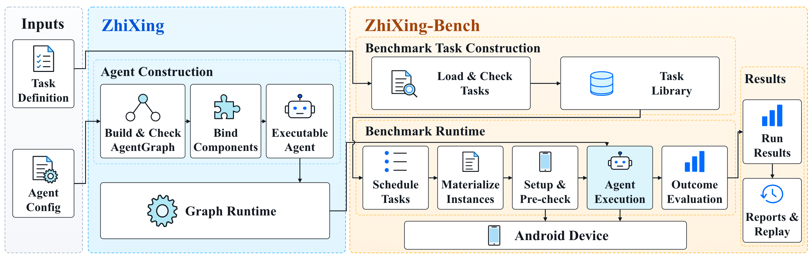

# 知行 ZhiXing

**用于构建与评测 Mobile GUI Agent 的统一框架**

[English](README.md) · [论文 artifact 指南](docs/paper-artifact.md) · [示例](examples) · [文档总览](docs/project-overview.md)

ZhiXing 将 Mobile GUI Agent 的构建与任务评测放在同一个框架中：通过可复用组件、
可组合的 AgentGraph 和共享 Graph Runtime 搭建 Agent 工作流，减少为每种实现单独
编写执行循环的工作。配套的 ZhiXing-Bench 提供声明式任务定义、可复用的初始化与
评估插件，以及自动化的任务结果评估。

一个 Agent 可以接收不同任务，既可以独立运行，也可以由 ZhiXing-Bench 调用。
Agent 配置与 Benchmark 任务定义相互独立，切换任务无需重新构造 Agent 工作流。

## 架构总览



整体流程由两部分组成：**ZhiXing 负责构建与执行 Agent**，**ZhiXing-Bench 负责
构建任务与评估任务结果**。Benchmark 执行复用前者构建的可执行 Agent 及其
Graph Runtime。

### ZhiXing：从 Agent 配置到执行

1. **构建并检查 AgentGraph。** 用 Python SDK 或图原生 YAML 描述组件节点、
   输入输出端口，以及数据边、控制边与反馈边。绑定组件前，检查组件合同、端口
   兼容性、依赖关系与有界反馈；这些检查无需调用模型或连接设备。
2. **绑定组件。** 解析组件引用，按配置参数和注入的依赖创建实例，再将接口绑定
   到图节点。组件实现自身能力，图中的连接决定组件之间如何协作。
3. **运行可执行 Agent。** Graph Runtime 调度已就绪的节点、传递输出并处理
   有界反馈，设备观察与动作执行经过显式设备接口。同一条执行路径可用于独立
   任务和 Benchmark。

详见 [AgentGraph 指南](docs/agent-graph.md)、[组件扩展](docs/external-components.md)
与 [Android Runtime 指南](docs/builtin-agentgraph-runtime.md)。旧版 `AgentConfig`
YAML 与兼容执行入口继续保留。

### ZhiXing-Bench：从任务定义到评估结果

1. **加载并检查任务。** 每个任务声明指令、可选参数生成器、环境初始化操作与
   评估规则；检查后的定义组成 Task Library。
2. **调度并生成实例。** 选择任务，根据声明的参数生成具体的 `TaskInstance`。
   独立的 `ExperimentProtocol` 控制随机种子、重复次数、预算与环境规则。
3. **环境准备与前置检查。** 准备任务初始环境，并为需要前后对比的检查记录
   执行前状态。
4. **调用 Agent。** 将任务交给已构建的可执行 Agent，由其 Graph Runtime 与
   设备接口完成执行。
5. **评估并保留结果。** Evaluation Tree 通过 AND、OR、THRESHOLD、WEIGHTED
   等操作组合可复用 Checker，输出任务判定，并保留结果、报告、结构化轨迹与
   Replay，供运行后检查。

Agent 执行状态与 Benchmark 结果分别记录：Agent 正常结束并不自动代表任务成功。
旧版 `BenchmarkTask` JSON 继续支持，同时也支持编译为 `BenchmarkPlan` 的
Benchmark Package。

详见 [Benchmark 架构](docs/benchmark-architecture.md)、
[任务编写](docs/benchmark-authoring.md)与 [Benchmark 运行](docs/benchmark-running.md)。

## 快速开始：无需手机或 API key

需要 Python 3.10+。本次发布仍在审阅中，请先获取发布分支：

```bash
git clone --branch codex/paper-core-release-20261023 https://github.com/apbocldueo/unimobile.git
cd unimobile
python -m pip install -e ".[openai,dev]"

# 使用 fake 组件完成 AgentGraph 构建、检查、绑定与执行。
python examples/agent_graph_runtime_no_device.py

# 检查自包含的 Benchmark 定义，不执行任务。
python -m zhixing.cli benchmark validate examples/benchmarks/minimal --json
```

图执行示例会打印节点事件、反馈过程与成功结束的 fake 运行结果；Benchmark 命令
返回定义检查及身份信息。两者均不连接手机或调用模型，也不证明 Android 任务成功。

## 示例与源码入口

| 内容 | 入口 |
| --- | --- |
| AgentGraph 构建 | [Python 示例](examples/agent_graph_no_device.py)、[图定义](examples/agent_graph/) |
| Runtime 调度与反馈 | [无设备执行](examples/agent_graph_runtime_no_device.py)、[更多图模式](examples/generalized_agent_graph_no_device.py) |
| Mobile Agent 工作流 | [图原生 YAML](examples/graphs/)、[Python SDK](examples/sdk/) |
| 外部可复用组件 | [插件示例](examples/external_component_plugin/)、[扩展指南](docs/external-components.md) |
| 任务构建 | [最小 Package](examples/benchmarks/minimal/)、[动态任务](examples/benchmarks/dynamic-task/) |
| 可组合的结果检查 | [Evaluation Tree 示例](examples/benchmarks/composite-evaluation/) |
| 论文机制与复验 | [论文与代码对应表、验证命令](docs/paper-artifact.md) |

核心实现在 [`zhixing/graph/`](zhixing/graph/)、
[`zhixing/components/`](zhixing/components/)、[`zhixing/runtime/`](zhixing/runtime/)、
[`zhixing/benchmark/`](zhixing/benchmark/) 和 [`zhixing/plugins/`](zhixing/plugins/)；
设备实现在 [`zhixing/devices/`](zhixing/devices/)。

## 在 Android 上运行

先按[设备指南](docs/device_setup.md)准备兼容的手机或模拟器，再在本地配置模型
端点与凭据：

```bash
cp secrets.example.yaml secrets.local.yaml
# 运行前填写 secrets.local.yaml。
adb devices
zhixing run \
  --agent examples/graphs/builtin_android_agent.yaml \
  --instruction "打开相机并拍一张照片，完成后结束任务" \
  --serial emulator-5554 \
  --secrets secrets.local.yaml
```

将 serial 替换为实际设备标识。该命令会执行真实设备动作并调用模型，其完成状态
不等同于独立 Benchmark 判定。配置与进一步的验证方式见
[Android Runtime 指南](docs/builtin-agentgraph-runtime.md)。

## 可选：ZhiXing Studio

Studio 提供 Agent 可视化编写、运行监控、Benchmark 配置、报告与 Replay 工作区。
安装 Python 依赖并准备 Node.js 22.12+ 后：

```bash
npm --prefix studio ci
python run_studio.py
```

启动器打开 `http://127.0.0.1:5173/`，按 Ctrl+C 一并关闭前后端。未配置模型与
设备时可先编写 Agent，执行前需要补齐对应的本地配置。详见
[本地启动说明](docs/studio-local-startup.md)。

## 发布范围与可复现性

当前为论文配套的**核心源码发布**，包含框架、保留的 Agent 示例、教学 Benchmark
Package、测试与 Studio。两份规范 AndroidWorld JSON 共保留 **116 个唯一任务
定义（81 + 35）**。完整任务媒体 Package、App 安装包、模拟器镜像和论文实验的
完整结果台账未随包分发，因此仅凭源码包不足以执行全部 116 个任务或复现论文
报告的实验结果。

按本次确定的范围，Agent-SAMA、AndroidArena、V-Droid 与 MobA 移植代码暂缓分发，
等待核实再分发授权；VisionTasker 的 GPL 源码集成也不进入本次 Apache 核心包。
具体边界见[论文 artifact 指南](docs/paper-artifact.md)与
[第三方版权说明](docs/third-party-notices.md)。

ZhiXing 处于 alpha 阶段，已有离线、fake-device 与有界 Android 验证证据；更广泛
的 Agent 与设备覆盖仍需验证。结构化轨迹用于审计和人工定位失败；第三方 Python
插件在宿主进程中运行。

## 贡献与引用

请参阅 [CONTRIBUTING.md](CONTRIBUTING.md)、[SECURITY.md](SECURITY.md) 与
[CITATION.cff](CITATION.cff)。ZhiXing 核心源码使用
[Apache License 2.0](LICENSE)，保留的第三方代码附有各自版权说明。
